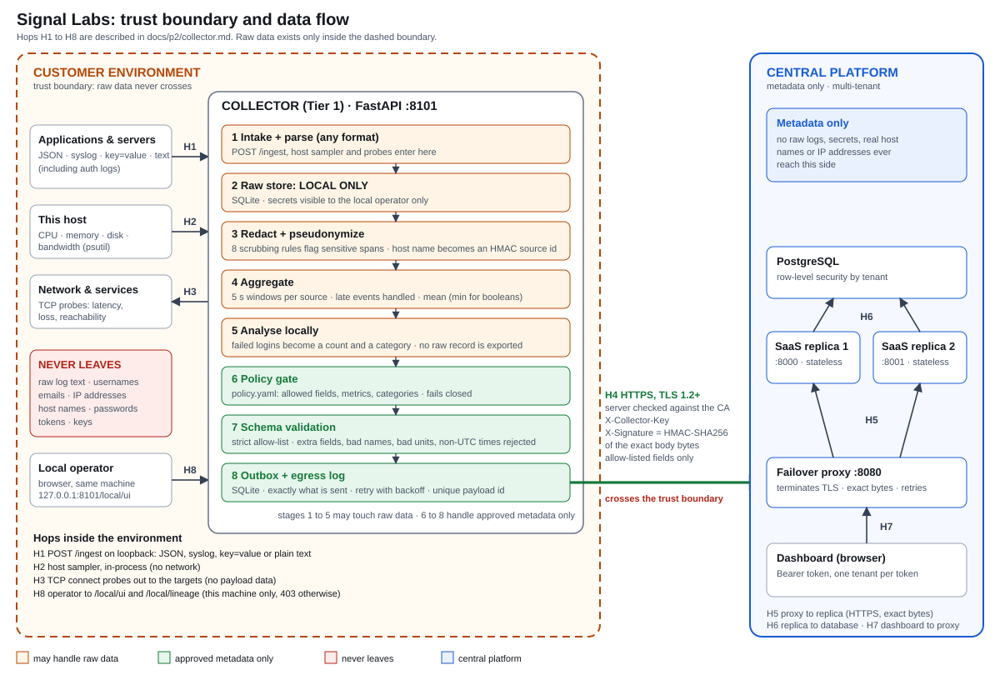

# Security and data protection (Member 1: collector side)

What leaves the customer environment, what never does, and how that is enforced. Every claim below names the code that enforces it and the test that proves it. Where something is not built or is weaker than production needs, it is listed under [Limits](#limits-and-what-production-would-need), not hidden.

Companion documents: [Phase 2 collector design](../p2/collector.md) and the [trust-boundary diagram](../p2/trust-boundary.svg).

---

## 1. Why raw telemetry stays local

- **Raw logs carry credentials and personal data.** Passwords, tokens, API keys, JWTs, usernames, emails, IP addresses and request bodies all show up in ordinary logs. Shipping them to a shared platform means one breach of that platform exposes every customer.
- **Compliance.** GDPR, India's DPDP Act, HIPAA and PCI-DSS restrict moving personal or regulated data. Numbers, timestamps and categories are far easier to justify.
- **Trust must be checkable.** A promise that "we don't send secrets" is weak. The collector therefore ships a local page that shows, for any payload, the raw records beside the exact bytes that left.
- **The platform does not need the raw text.** Health, trends, anomalies and correlation work from numbers, timestamps, categories and severity.

## 2. The trust boundary

Everything left of hop H4 runs inside the customer environment and may touch raw data. Everything that crosses H4 has passed the policy gate and the schema check. The diagram labels every hop.

## 3. What stays, what is scrubbed, what is sent

### 3.1 Sent (the only fields that can leave)

The payload shape is defined once, in [`collector/schema.py`](../../collector/schema.py), and exported to [`contracts/payload.schema.json`](../../contracts/payload.schema.json). Every other field is rejected, because there is nowhere for it to travel.

| Field | Example | Marking | How it is produced |
|---|---|---|---|
| `payload_id` | `c794f095-a282-4988-…` | allowed metadata | random UUID; lets retries be de-duplicated |
| `tenant_ref`, `collector_id`, `region` | `t-acme`, `col-blr-01`, `in` | allowed metadata | configuration; the SaaS checks them against the credential |
| `source_id` | `src_314c4f3d8339` | **pseudonymized** | HMAC-SHA256 of the host name with a secret that never leaves, first 12 hex characters |
| `event_ts_utc`, `source_tz`, `window_s` | `2026-11-20T14:29:51Z`, `UTC`, `5` | allowed metadata | UTC time of the newest record in the window; IANA zone from `SOURCE_TZ` |
| `metric` | `cpu_pct = 38.4 %` | allowed metadata | window mean (minimum for booleans); name and unit from fixed lists |
| `event` | `auth_failure_burst`, `high`, count 42, "repeated failed logins" | **derived summary** | computed locally; the summary text is a template, never copied from a log |
| `health_state`, `collector_version` | `Good`, `0.1.0` | derived summary / allowed | see limits: the health verdict is currently constant |

Allowed metrics: `cpu_pct`, `mem_pct`, `disk_pct`, `bandwidth_mbps`, `latency_ms`, `packet_loss_pct`, `service_up`, `connectivity_up`. Allowed event categories: `auth_failure`, `auth_failure_burst`, `service_state`, `network_event`, `security_event`, `log_event`.

### 3.2 Scrubbed or dropped (stays local)

| Raw content | Treatment | Where it lives |
|---|---|---|
| Passwords, tokens, API keys, bearer tokens, JWTs, AWS keys, private keys | detected by 6 rules; never copied anywhere near a payload | local raw store only |
| Emails, usernames | detected (email) or counted (username); never sent | local raw store only |
| IP addresses, host names | never sent as text; a host becomes a pseudonymous `source_id` | local raw store only |
| Log lines and message bodies | replaced by a **count** and a template summary | local raw store only |
| Anything not in the allow-list | cannot be expressed in a payload | n/a |

Example (a real record from the test run): the line `app[1]: password=Sup3rS3cret! from 10.9.8.7` is kept locally with `password` and `ipv4` highlighted. The payload that left says `log_event, count 1, "log events observed"` from `src_314c4f3d8339`. Neither the password, the IP nor the host name appears in it.

### 3.3 Who can see what

| Who | Raw records | Egress log and panel | Platform metadata | Another tenant's data |
|---|---|---|---|---|
| Customer operator at the collector | yes (this machine only) | yes | via the dashboard, own tenant | never |
| Dashboard user (a viewer or operator role) | no | no | own tenant only | never |
| The platform operator | no | no | not by design (see limits) | never |

## 4. Controls, and the evidence for each

| Control | How it works | Code | Proof |
|---|---|---|---|
| **Allow-list schema** | strict models; unknown fields, unknown metric names, wrong units, non-UTC times and free-form summaries are rejected | `collector/schema.py` | `tests/test_schema.py` |
| **Second gate: data policy** | `policy.yaml` marks each field and lists allowed metrics and categories; payloads are checked before queueing; fails closed, including when the policy forbids a field the schema requires | `collector/policy.py`, `policy.yaml` | `tests/test_policy.py` |
| **Secret scrubbing** | regex rules find sensitive spans in each raw line; the line itself stays local | `collector/redact.py` | `tests/test_redact_pipeline.py`, `test_egress_ui.py` |
| **No free text in payloads** | event summaries are fixed templates | `collector/local_analysis.py` | `tests/test_aggregate.py::test_burst_payload_leaks_no_username_ip_or_message` |
| **Pseudonymous source IDs** | HMAC with a local secret; stable per host, not reversible without the secret | `collector/redact.py` | `tests/test_redact_pipeline.py` |
| **Local analysis** | failed logins become a count and a category, so the raw authentication records are never exported | `collector/aggregate.py`, `local_analysis.py` | `tests/test_aggregate.py` |
| **Collector authentication** | each request carries `X-Collector-Key` and `X-Signature`, an HMAC-SHA256 of the exact body; the platform takes tenant and collector identity from the key, not the payload | `collector/sender.py` | `tests/test_saas_compat.py`; the `tls` scenario shows a changed body returns 401 |
| **Encrypted transport** | HTTPS, TLS 1.2 minimum, server certificate and name always verified, only the configured CA trusted; `REQUIRE_TLS=1` refuses to start on a non-https URL | `collector/sender.py`, `devcerts.py` | `tests/test_tls.py` |
| **Auditable transfer records** | every payload is stored in the local outbox exactly as queued, with its status, attempts and timestamps, plus the raw record IDs and scrubbing rules behind it | `collector/outbox.py` | `tests/test_aggregate.py` (lineage IDs), `/local/lineage/<id>` |
| **Egress proof panel** | `/local/ui` shows raw records beside the exact payload and searches the payload for every sensitive value found in the raw text | `collector/ui/` | `tests/test_egress_ui.py` |
| **Local-only views** | `/local/*` answers only this machine (403 otherwise) | `collector/main.py` | `tests/test_egress_ui.py` |
| **Safe page rendering** | log text is attacker-controlled; the page uses text nodes only under a strict CSP | `collector/ui/app.js` | `tests/test_egress_ui.py` (regression guard), checked in a browser with an injected `<script>` |

## 5. Tenant separation

The collector only ever knows its own tenant. On the platform, identity comes from the authenticated key and a payload claiming another tenant or collector is refused; data is stored under the credential's tenant. The platform side of isolation (row-level security) is documented in Member 2's SaaS document.

## 6. Questions a judge may ask

| Question | Short answer |
|---|---|
| What exactly leaves, and what stays? | Section 3. Show the egress panel at `/local/ui`. |
| How does it decide which fields are sent? | Two gates: the schema and `policy.yaml`. A field in neither cannot leave. |
| How do you stop a secret leaking by accident? | Free text has no field to travel in, so even a scrubbing rule that misses a secret cannot send it. The scrubber only decides what to highlight and flag locally. |
| How are collectors authenticated and encrypted? | Key plus HMAC-SHA256 of the body; TLS 1.2+ with a pinned CA. |
| Can you show the last payload? | `/local/ui`, or `/local/egress?limit=1`. |

## Limits and what production would need

Said plainly, because honest limits are scored:

- **Scrubbing is pattern-based.** A novel secret format can be missed by the scrubber. It does not leak (see above) but it will not be highlighted. Production should add entropy checks and a periodic review.
- **Local retention is not enforced yet.** `LocalStore.purge_raw` exists but nothing calls it, and the outbox (the audit record) is never pruned, so the local database grows without limit. Raw records may therefore outlive any retention policy. This is task E7.
- **Audit records are not tamper-evident.** They are rows in a local SQLite file. A hash chain or write-once storage would be needed.
- **Dev secrets are the defaults.** `COLLECTOR_KEY`, `COLLECTOR_SECRET` and `PSEUDO_SECRET` default to development values. Production needs per-collector secrets from a secrets manager, rotation, and enrollment with a one-time token (not built; the collector reads them from the environment). Changing `PSEUDO_SECRET` changes every `source_id`.
- **No client certificates.** TLS authenticates the server; the collector authenticates with a key and signature. mTLS would add a second factor.
- **`/ingest` is not restricted to this machine.** Only the `/local/*` views are. Bind the collector to a local interface (the runner does) or put authentication in front if other hosts must send to it.
- **The platform operator can see tenant metadata** in the database. Whether operators can query it is a Member 2 access-control question.
- **The local health verdict is a constant** (`Good`). Health is computed by the platform from the metrics.
- **Failed-login detection is per 5-second window.** A slow trickle below the threshold in every window appears as warnings, not one burst.
- **TCP-connect probe, not ICMP.** The "packet loss" metric is the share of failed connection attempts.
