# Phase 2 architecture and trust boundary

```mermaid
flowchart LR
  subgraph Customer[Customer environment · Member 1]
    S[Applications, host, network, security] -->|raw local telemetry| C[Collector adapter]
    C -->|raw records retained locally| R[Local retention]
    C -->|filter and redact| A[Aggregate and local analysis]
    A -->|metadata policy| P[Allow-list and egress proof]
    P -->|approved payload + UUID| O[Durable local outbox]
    L[Local operator] -->|authorized local access| R
    L -->|inspect exact outgoing payload| P
  end
  subgraph Regional[Assigned regional SaaS · Member 2]
    I[Ingest: key + HMAC + contract] -->|identity from credential| D[(Region-bound Postgres\ntransaction-local tenant RLS)]
    D --> F[Health + history]
    D --> AI[Baseline + persistence + correlation]
    AI --> N[Incidents + signal evidence]
    N --> REC[Explainable recommendation]
    REC --> ACT[Simulated action + approval + audit]
    D --> OBJ[Object and lineage API]
    OBJ --> UI[Authenticated dashboard]
    F --> UI
    ACT --> UI
  end
  O -->|TLS 1.2+, server verified · signed metadata only| I
  UI -->|client render acknowledgement| I
```

The boundary is crossed only by an allow-listed payload. The collector's sender always verifies the server certificate and name against the configured CA (TLS 1.2 or later) and can refuse plain HTTP (`REQUIRE_TLS=1`); `scripts\run-local.ps1 -Tls` runs the whole local stack that way with a private dev CA. Local aggregation, analysis and the policy gate run before anything is queued, and the real egress proof panel is served by the collector at `/local/ui`. This was validated end to end on one machine; see [the collector design](collector.md) for the hop-by-hop detail and its diagram. The central code does not receive local raw records.

A regional endpoint uses its own database, with a one-region database binding on startup. Two replicas within a region can share that database and tenant-scoped transactions; separate databases are needed for separate regions. The first replica binds an empty database to its configured region; deployment must verify the intended region before startup. This does not establish geographic residency by itself. A single regional database is a failure point. A failover proxy (`scripts/lb.py`) sits in front of the replicas, and killing one replica mid-stream was measured on one machine: no payloads missing and no duplicates stored, by comparing payload ID sets. No throughput guarantee is claimed.

Each metadata payload carries UTC event time and a UUID. Unique `(tenant_id,id)` constraints distinguish duplicate retries from different bodies under the same ID. The current incident links retain up to 100 recent signals; late events are stored by event time, but historical anomaly decisions are not recalculated. Source correlations are heuristic and confidence is not a calibrated probability.

Regional local test configurations use separate `DATABASE_URL` values and `REGION=in`/`REGION=eu`. `.\scripts\run-local.ps1 -Tls` does this for the local stack with a private dev CA (made by `python -m collector.devcerts`). By hand, for TLS on the SaaS side, start Uvicorn with `--ssl-certfile <server-cert> --ssl-keyfile <server-key>` and configure the collector to verify the corresponding CA. Never use the local development keys or HTTP across a real trust boundary.
