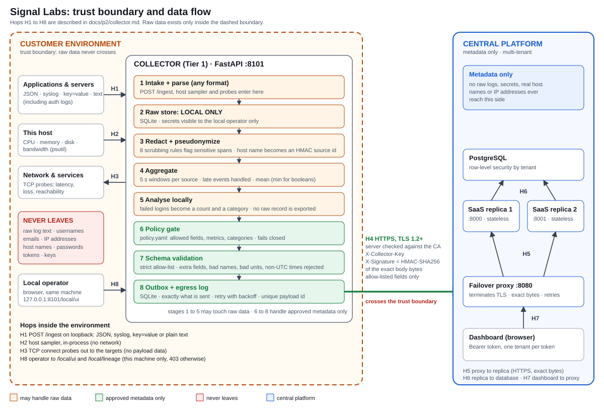

# Phase 2: collector design (Member 1)

Tier 1 of the two-tier design: everything that runs inside the customer environment. The central platform half is in `docs/p2/saas.md` (Member 2). Security detail and its limits are in [security-and-data-protection.md](../p1/security-and-data-protection.md).

---

## 1. Data flow, every hop labeled

| Hop | From → to | Transport | What crosses it | Protection |
|---|---|---|---|---|
| **H1** | applications and servers → collector | `POST /ingest`, one record per line, any of JSON / syslog / key=value / plain text | raw log and metric lines | stays inside the environment; bind the collector to a local interface |
| **H2** | this host → collector | in-process (`psutil`) | CPU, memory, disk, bandwidth readings | none needed, no network |
| **H3** | collector → probe targets | TCP connect, outbound | connect attempts only | none; no payload data is sent |
| **H4** | collector → failover proxy | **HTTPS**, TLS 1.2+, server certificate and name verified against the configured CA | allow-listed payloads in a JSON array (max 50 per request) | `X-Collector-Key`, `X-Signature` = HMAC-SHA256 of the exact body; **this hop crosses the trust boundary** |
| **H5** | proxy → SaaS replica 1 or 2 | HTTPS, verified, exact bytes forwarded | the same request | signature still valid, because bytes are untouched |
| **H6** | replica → Postgres | TCP (TLS in production) | stored metadata, scoped by tenant | row-level security (Member 2) |
| **H7** | dashboard browser → proxy | HTTPS | read queries | `Authorization: Bearer` token bound to one tenant |
| **H8** | local operator → collector UI | HTTP on 127.0.0.1 | raw records, egress log, policy | answers this machine only (403 otherwise) |

Heartbeats use the same H4 path with the same authentication.

## 2. Pipeline inside the collector

Order of stages, with the module and what each guarantees. Stages ① to ⑤ may touch raw data; ⑥ to ⑧ handle only approved metadata.

| # | Stage | Module | What it does |
|---|---|---|---|
| ① | Intake and parse | `parsers/`, `sources/host.py`, `main.py` | Detects the format (JSON, syslog, key=value, text; unknown falls back to text) and normalizes to one record. A bad line never stops the stream. Host and probe sources produce the same record shape |
| ② | Raw store | `outbox.py` (`raw` table) | Keeps the original line, with its scrubbing rules, in SQLite. **Never sent.** Lets the operator see raw data locally |
| ③ | Redact and pseudonymize | `redact.py`, `policy.py` | Finds sensitive spans (8 rules) for highlighting and flagging; turns the host name into an HMAC `source_id` |
| ④ | Aggregate | `aggregate.py` | Groups records per source and 5-second window, assigned by each record's event time; a window is sent once the collector's clock passes its end plus a 2 s grace; a record that arrives after its window was sent goes out alone (marked late). Mean for gauges, minimum for booleans |
| ⑤ | Analyse locally | `local_analysis.py` | Counts failed logins per source per window; 5 or more is `auth_failure_burst` (high), 25 or more is critical; only the count and category leave |
| ⑥ | Policy gate | `policy.py`, `policy.yaml` | The customer's allow-list: fields, metrics, event categories; fails closed |
| ⑦ | Schema validation | `schema.py` | Strict payload model; extra fields, bad names, bad units and non-UTC times are rejected |
| ⑧ | Outbox and egress log | `outbox.py`, `sender.py` | Stores the payload exactly as it will be sent, then delivers it with retries |

## 3. Telemetry plan

| Metric | Source | How it is measured |
|---|---|---|
| `cpu_pct` | host | `psutil.cpu_percent`, primed at start, sampled every 2 s |
| `mem_pct` | host | `virtual_memory().percent` |
| `disk_pct` | host | `disk_usage` of each `DISK_PATHS` entry (default: the system drive); the **fullest** disk is reported |
| `bandwidth_mbps` | host | bytes in plus out across all interfaces, differenced between samples; a counter reset gives 0, never a negative |
| `latency_ms` | probe | median TCP connect time over 4 attempts to each target (default: the SaaS path; add more with `PROBE_TARGETS`) |
| `packet_loss_pct` | probe | share of failed connect attempts. This is a TCP measurement, not ICMP; it tracks a degrading link but is not identical to packet loss |
| `connectivity_up` | probe | 1 if any attempt succeeded, else 0 |
| `service_up` | probe | TCP reachability of each `SERVICE_CHECKS` entry, one source per service |
| failed logins | log lines | parsed and counted locally (stage ⑤) |

Each host, probe path and service is its own pseudonymous source, so one bad path does not hide behind a healthy host. The collector can also take any of these as text through H1 (so the organizer's stream can be plugged in by writing one parser).

## 4. Reliability and failure handling

| Situation | Behaviour | Proof |
|---|---|---|
| **Platform unreachable** | payloads stay in the SQLite outbox as `pending`; retry per payload with exponential backoff, `min(30 s, 2^attempts)`; sending resumes when the platform answers | `outage` scenario; `tests/test_tls.py` (failed delivery keeps the payload buffered) |
| **Duplicate delivery after a retry** | every payload has a unique `payload_id`; the platform stores each once and reports repeats as `duplicate`, which the collector treats as delivered | `delivery` scenario |
| **Same ID, different body** | the platform reports `conflict`; the collector closes it out and surfaces it in `last_error`, not retrying forever | `collector/sender.py` |
| **One bad payload in a batch** | a batch-level rejection is retried one payload at a time, so one bad record cannot block the rest; a permanently refused payload is marked `rejected` | `collector/sender.py` |
| **A replica dies mid-stream** | the failover proxy sends the next request to the other replica with the same bytes | `failover` scenario, `tests/test_lb.py` |
| **Late or out-of-order records** | records are placed in windows by event time and windows close after a grace period; late records are sent alone and ordered by event time on the platform | `tests/test_aggregate.py`, `delivery` scenario |
| **Clock** | all event times are UTC and carry a source timezone (`SOURCE_TZ`, default UTC) | `schema.py` |
| **Flood, or a very long outage** | caps are enforced as data is written: raw rows (500,000), live database size (1 GiB), pending payloads (100,000). When the outbox is full the **oldest** pending payloads are dropped first. Every drop is counted at `/local/retention` and reported to the platform as a `service_state` event; a scheduled job also deletes expired data (raw after 24 h, delivered records after 7 days) | `tests/test_retention.py` (10,000-line flood), `flood` scenario: 40,000 lines left 500 raw rows, 201 pending payloads and 0.3 MiB on disk |
| **Oversize input** | a line over 65,536 characters is never parsed (a short marker is kept); a request body over 8 MiB is refused with 413 and is read in pieces, so it cannot exhaust memory | `tests/test_retention.py` |
| **Malformed input** | parsed defensively; a bad line is counted and skipped | `tests/test_redact_pipeline.py` |

**Zero loss is proven by ID set, not by count.** `demo.ps1 outage` and `demo.ps1 failover` compare the payload IDs the collector created with the IDs the platform holds, judging only payloads old enough to have settled. In the recorded runs: 3,593 judged and 0 missing (outage), 10,866 judged and 0 missing, 0 duplicates stored (failover).

**What a crash would lose.** Records waiting in an open aggregation window are held in memory and flushed on a normal shutdown, but not on a hard kill. That is at most one window plus the grace period (about 7 seconds) of data. Everything already in the outbox survives a restart.

## 5. Security controls

| Control | Where | See |
|---|---|---|
| Collector authentication (key and body signature) | `sender.py` | security doc, section 4 |
| TLS 1.2+, verified server, pinned CA, optional require-TLS | `sender.py`, `devcerts.py` | security doc, section 4 |
| Allow-list schema and data policy | `schema.py`, `policy.py` | security doc, section 3 |
| Secret scrubbing and pseudonymous IDs | `redact.py` | security doc, section 3 |
| Auditable transfer records and the egress proof panel | `outbox.py`, `ui/` | security doc, section 4 |
| Local retention and size limits | `outbox.py`, `main.py` | security doc, section 4 |
| Enrollment with a one-time token | `enroll.py`, `credentials.py` | security doc, section 4 |

## 6. Global-ready design (collector side)

| Concern | What the collector does | Platform side |
|---|---|---|
| **UTC** | every timestamp is UTC; the source timezone is sent separately so dashboards render locally | stores and orders by UTC event time |
| **Out-of-order** | places records in windows by event time, sends late records alone | places them by event time, not arrival time |
| **Idempotent delivery** | unique `payload_id`, safe to resend | de-duplicates per tenant |
| **Regional ingest** | each collector has one configured `SAAS_URL` and `region`; pointing it at the regional endpoint is a configuration change | region is bound to the credential; a request for a different region is refused |
| **Data residency** | nothing replicates anywhere by itself | per-tenant regional storage is a design answer; the live demo runs one region |

## 7. Scalability

- **Many collectors.** Each collector is independent and keyed by its own credential, so adding collectors adds no shared state on the collector side. The platform scales on its own (stateless replicas).
- **Volume per collector (an estimate, not a measurement).** With the defaults (5 s windows, 4 host metrics, 3 per probe path, 1 per service), a collector produces on the order of 10 payloads per 5 s window, or roughly 2 per second. At about 300 to 400 bytes each that is on the order of 60 MB a day uncompressed. Aggregation exists precisely to keep this flat as log volume grows: 40 failed-login lines are one payload.
- **Batching.** Up to 50 payloads per request.
- **Bounded storage.** The disk footprint is capped by configuration (see the flood row in section 4), so a collector's disk use does not grow with log volume.
- **Known ceilings.** One SQLite file with a single lock, no request compression, a polled (not pushed) failover check. A larger deployment would use a queue (for example NATS or Kafka) between collection and delivery, and a time-series store behind the platform.

## 8. How to demo each Phase 2 line

| Sheet item | Command | What to point at |
|---|---|---|
| Two-tier with an authenticated link | `.\scripts\run-local.ps1 -Tls`, then `.\scripts\demo.ps1 tls` | plain HTTP refused, other CA rejected, tampered body returns 401 |
| Collect → redact → aggregate → analyse → policy → send | `http://127.0.0.1:8101/local/pipeline` and `/local/policy` | counters per stage; each field's marking |
| Allow-listing, scrubbing, pseudonymous IDs | `.\scripts\demo.ps1 secret`, then `/local/ui` | secret highlighted on the left, absent on the right, leak check green |
| Auth, TLS, audit | `/local/lineage/<id>` | raw record IDs, redactions, status and attempts for one payload |
| Telemetry: CPU, memory, disk, bandwidth, latency, packet loss | `http://127.0.0.1:8101/local/host` (start with `-NoSimulator`) | real values from this machine |
| Reliability and failure handling | `.\scripts\demo.ps1 outage`, `failover`, `flood` | buffered count, then zero missing by ID set; a flood stays within its caps and the loss is reported |
| Authentication and enrollment | `.\scripts\run-local.ps1 -Tls`, then `.\scripts\demo.ps1 enroll` | a collector with no keys enrolls itself, appears online, and its token is single-use |
| UTC, out-of-order, idempotent | `.\scripts\demo.ps1 delivery` | duplicate stored once, late event ordered by event time, conflict detected |

## 9. Tests that back the claims

| Claim | Test file |
|---|---|
| Secrets never reach the outbox; raw stays local | `test_redact_pipeline.py`, `test_aggregate.py`, `test_egress_ui.py` |
| Extra fields, bad names, units and times are rejected | `test_schema.py` |
| The committed contract matches the schema | `test_contract_frozen.py` |
| The collector's payloads are valid for the platform | `test_saas_compat.py` |
| Aggregation, late events, burst detection | `test_aggregate.py` |
| Policy enforcement, fail-closed, malformed policy | `test_policy.py` |
| Host telemetry and probes | `test_host.py` |
| TLS: valid, wrong CA, wrong name, plain HTTP, require-TLS | `test_tls.py` |
| Egress panel, local-only guard, safe rendering | `test_egress_ui.py` |
| Failover proxy | `test_lb.py` |
| Retention, size caps, oversize input, loss reporting | `test_retention.py` |
| Enrollment: single-use token, TLS-only, credentials file, no secret in output | `test_enroll.py` |

Run them with `python -m pytest collector saas -q`. The TLS tests skip unless `cryptography` is installed.

## 10. Limits and production gaps

See the full list in [the security document](../p1/security-and-data-protection.md#limits-and-what-production-would-need). The ones that matter most for this design:

- under a flood or a long outage the oldest undelivered data is dropped by design (counted and reported, never silent);
- unenrolled collectors fall back to dev credentials, and credential rotation and revocation are not built;
- no client certificates, and the audit record is not tamper-evident;
- the local health verdict is constant; failed-login detection is per window;
- no compression and a single SQLite writer limit throughput.
